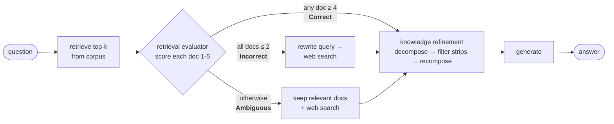
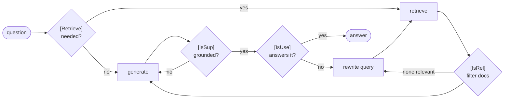

# 🔁 reflective-rag

[](https://github.com/hasnat23/reflective-rag/actions/workflows/ci.yml)
[](https://www.python.org/downloads/)
[](https://langchain-ai.github.io/langgraph/)
[](LICENSE)

**Corrective RAG (CRAG) and Self-RAG, implemented as LangGraph graphs**, with a naive-RAG baseline and an evaluation harness on
HotpotQA that tests the case these methods were designed for: **what happens when retrieval fails.**

**⚠️ Note:** these are independent implementations inspired by the papers. The papers train dedicated models (a T5 retrieval
evaluator in CRAG, reflection tokens in Self-RAG). Here every judgement is a **prompted call to the same chat model**, so the
methods work with any LLM, including small local ones via Ollama. Results will differ from the papers.

## 📄 Papers

| Method | Paper |
|---|---|
| **CRAG** | Yan et al., *Corrective Retrieval Augmented Generation*, 2024, [arXiv:2401.15884](https://arxiv.org/abs/2401.15884) |
| **Self-RAG** | Asai et al., *Self-RAG: Learning to Retrieve, Generate, and Critique through Self-Reflection*, 2023, [arXiv:2310.11511](https://arxiv.org/abs/2310.11511) |

## 🧠 How they work

### Corrective RAG

A **retrieval evaluator** scores every retrieved passage (1–5) and picks one of three actions:



*Knowledge refinement* splits documents into sentence strips and keeps only the strips the evaluator marks as useful
("decompose-then-recompose"). The web search uses Wikipedia's API (keyless); swap in any search tool.

### Self-RAG

Four reflection decisions, each a prompted judgement:



Every loop is bounded (`max_retrievals`, `max_generations`), so the graph always terminates. That's covered by the tests.

## 🚀 Quickstart

```bash
pip install git+https://github.com/hasnat23/reflective-rag
ollama pull llama3.2:3b && ollama pull nomic-embed-text

rrag ask "Who founded the company?" --docs ./my_notes --method crag
```

```
  · retrieve: 1 docs
  · evaluate: scores=[5] -> correct
  · refine: 1 -> 1 docs
  · generate

According to document [1], Acme Robotics was founded in 2017 by Lena Fischer and Omar Haddad in Koblenz, Germany.

sources: acme.md   (3 LLM calls, 11.8s)
```

Use any provider supported by LangChain's `init_chat_model`:

```bash
export RRAG_PROVIDER=openai RRAG_MODEL=gpt-4o-mini RRAG_EMBEDDING_PROVIDER=openai RRAG_EMBEDDING_MODEL=text-embedding-3-small
pip install "reflective-rag[openai] @ git+https://github.com/hasnat23/reflective-rag"
```

### Python API

```python
from reflective_rag import CorrectiveRAG, SelfRAG, Corpus, Settings
from reflective_rag.llm import get_chat_model, get_embeddings

settings = Settings()
corpus = Corpus.from_texts(get_embeddings(settings), texts, titles)
rag = CorrectiveRAG(get_chat_model(settings), corpus, settings)

result = rag.invoke("Which tower was completed in 1889?")
result.answer, result.trace, result.llm_calls, result.extra["action"]
print(rag.mermaid())        # the compiled graph as a Mermaid diagram
```

## 📊 Evaluation

`evaluation/hotpot.py` samples HotpotQA (distractor setting) questions and builds a corpus from all their context paragraphs
(2 gold + 8 distractors each). It runs two conditions:

- **standard**: gold paragraphs are in the corpus
- **knowledge gap**: gold paragraphs are **removed**, so a correct answer needs a fallback to external knowledge

```bash
pip install -e ".[eval]"
python evaluation/hotpot.py --n 50
```

### Results: `llama3.2:3b` + `nomic-embed-text` (Ollama, 8 GB M1), 30 questions, seed 13

**Standard** (gold passages in the corpus)

| Method | EM % | F1 % | Answer-contains % | LLM calls / q | Seconds / q |
|---|---:|---:|---:|---:|---:|
| Naive RAG | 26.7 | 44.9 | 40.0 | 1.0 | 2.3 |
| CRAG | 20.0 | 35.0 | 30.0 | 6.7 | 9.1 |
| Self-RAG | 23.3 | 29.1 | 30.0 | 10.5 | 7.2 |

**Knowledge gap** (gold passages removed)

| Method | EM % | F1 % | Answer-contains % | LLM calls / q | Seconds / q |
|---|---:|---:|---:|---:|---:|
| Naive RAG | 3.3 | 6.3 | 6.7 | 1.0 | 4.1 |
| CRAG | 13.3 | 16.3 | 16.7 | 7.6 | 15.1 |
| Self-RAG | 13.3 | 17.1 | 20.0 | 9.6 | 15.3 |

**What this shows**

- 🎯 **CRAG does what it was designed for.** When retrieval fails, its Wikipedia fallback lifts exact match from **3.3% to 13.3%** (4×) over naive RAG.
- ⚖️ **Reflection isn't free.** When retrieval already works, naive RAG wins. With a 3B model, every extra grading call is
  another chance to discard a good passage (CRAG keeps only strips the evaluator marks useful), and CRAG costs ~7× the LLM calls.
- 🔍 **The evaluator is the bottleneck.** In the knowledge-gap setting, CRAG still rated retrieval *Correct* in 14 of 30 questions
  even though the gold passages were removed. Plausible distractors fooled the 3B grader, and only 1 of those 14 was answered correctly
  (vs. 3 of 16 routed to web search). This is why the CRAG paper trains a dedicated evaluator.
- 🤔 **Self-RAG skipped retrieval on 12 of 30 questions** ("[Retrieve] no") and answered from memory, which hurts on multi-hop
  HotpotQA questions in the standard setting but helps a little when the corpus is useless.

These are small-sample numbers (30 questions, ±~8 pp). Per-question traces are in [`evaluation/results/`](evaluation/results/), and
`python evaluation/hotpot.py --n 200` with a larger model (`RRAG_PROVIDER=openai`) gives a more reliable comparison.

## 🧱 Project structure

```
src/reflective_rag/
  graphs/naive.py      # baseline
  graphs/crag.py       # Corrective RAG
  graphs/self_rag.py   # Self-RAG
  graders.py           # prompted reflection steps + lenient JSON parsing
  retrieval.py         # in-memory vector store, Wikipedia search
  llm.py               # model factories, LLM-call/token counter
evaluation/hotpot.py   # HotpotQA harness (standard + knowledge-gap)
tests/                 # routing tests with a scripted fake LLM (no network)
```

## 🧪 Tests

```bash
pip install -e ".[dev]" && pytest
```

The tests drive every branch of both graphs (correct / incorrect / ambiguous, regenerate, rewrite, bounded loops) with a
scripted fake LLM and deterministic embeddings.

## 📄 License

MIT © Muhammad Hasnat
